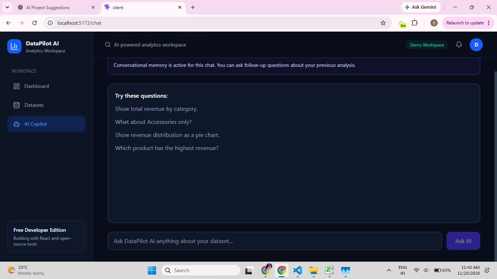
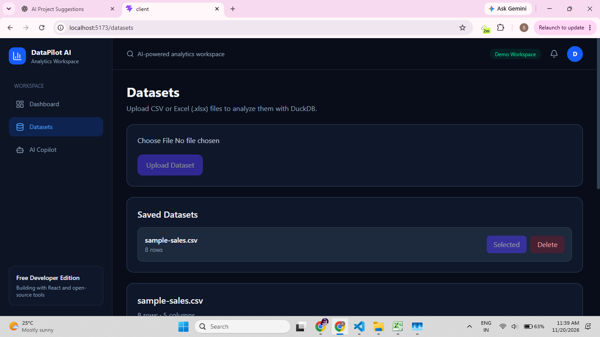
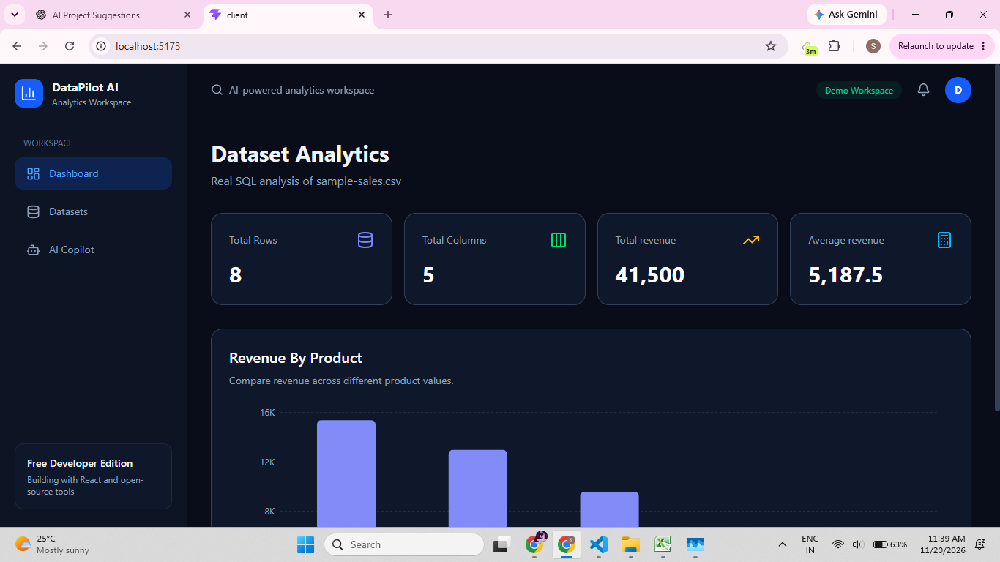
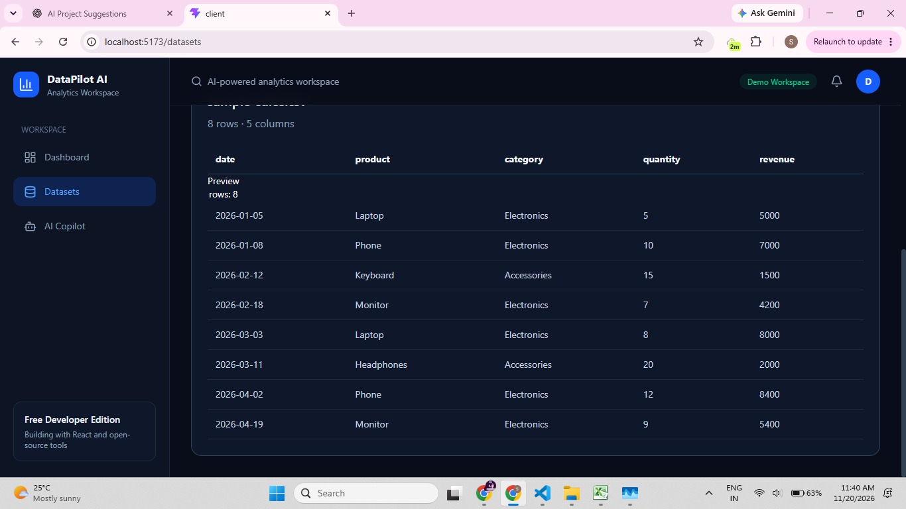

# DataPilot AI — AI-Powered Data Analytics Platform

DataPilot AI is a full-stack, AI-powered data analytics application that allows users to upload datasets, explore data, generate SQL queries using natural language, and visualize analytical results.

Built with **React, Node.js, Express, DuckDB, and Ollama**, the platform combines traditional SQL analytics with local Large Language Models (LLMs) to make data analysis more accessible.

## Features

- **CSV and Excel Upload:** Upload datasets in `.csv` and `.xlsx` formats.
- **Interactive Dashboard:** View dataset statistics, numerical summaries, and charts.
- **Natural Language Analytics:** Ask questions about uploaded datasets in everyday language.
- **AI-Powered SQL Generation:** Generate analytical SQL queries using Ollama.
- **SQL Execution:** Execute validated analytical queries against DuckDB.
- **Data Visualization:** Display results using bar, line, and pie charts.
- **Conversational Analytics:** Ask follow-up questions using previous analysis context.
- **AI-Generated Insights:** Present meaningful summaries of analytical results.
- **Persistent Dataset Storage:** Store uploaded datasets using DuckDB.
- **Conversation Persistence:** Preserve chat history within the browser session for each dataset.
- **Error Handling:** Handle invalid requests, AI service failures, and unsupported queries.

## Tech Stack

| Layer | Technologies |
|---|---|
| Frontend | React.js, Vite, Tailwind CSS |
| Backend | Node.js, Express.js |
| Database | DuckDB |
| AI Integration | Ollama, Qwen2.5-Coder 3B |
| Visualization | Recharts |
| File Processing | CSV Parser, ExcelJS |
| Version Control | Git, GitHub |

## System Architecture

```text
                User
                 |
                 v
         React Frontend
                 |
                 v
          Express REST API
                 |
        +--------+--------+
        |                 |
        v                 v
    Dataset API       AI Copilot API
        |                 |
        v                 v
     DuckDB          Ollama LLM
        ^                 |
        |                 v
        +---------- SQL Plan
                    |
                    v
             SQL Validation
                    |
                    v
             DuckDB Execution
                    |
                    v
             Results & Insights
                    |
                    v
               React Charts
```

## How It Works

1. **Upload a dataset:** The user uploads a CSV or Excel file.
2. **Store the data:** The backend processes the file and stores its data in DuckDB.
3. **Ask a question:** The user submits a natural-language analytical question.
4. **Generate a SQL plan:** Ollama interprets the question and generates a structured analysis plan.
5. **Validate the query:** The backend compiles the plan into a restricted analytical SQL query.
6. **Execute the query:** DuckDB processes the query and returns the results.
7. **Display the analysis:** The frontend presents the results as tables, charts, and insights.

## Project Structure

```text
AI-DATA-ANALYST/
|
|-- client/
|   |-- src/
|   |   |-- components/
|   |   |-- pages/
|   |   |-- services/
|   |   |-- App.jsx
|   |   |-- main.jsx
|   |
|   |-- package.json
|   |-- vite.config.js
|
|-- server/
|   |-- src/
|   |   |-- controllers/
|   |   |-- middleware/
|   |   |-- routes/
|   |   |-- services/
|   |   |-- app.js
|   |   |-- server.js
|   |
|   |-- sales.csv
|   |-- inventory.csv
|   |-- package.json
|
|-- README.md
```

## Installation and Setup

### Prerequisites

Install the following:

- Node.js and npm
- Git
- Ollama

### 1. Clone the Repository

```bash
git clone https://github.com/sujalgupta7601/AI_DATA_ANALYST.git
cd AI_DATA_ANALYST
```

The completed project is available on the `master` branch.

### 2. Install Backend Dependencies

```bash
cd server
npm install
```

Create a `.env` file using the provided `.env.example` as a reference.

### 3. Install Frontend Dependencies

Open another terminal:

```bash
cd client
npm install
```

Create a `.env` file using `client/.env.example` as a reference if needed.

### 4. Set Up Ollama

Download Ollama from https://ollama.com.

Install the AI model:

```bash
ollama pull qwen2.5-coder:3b
```

Make sure the Ollama service is running.

### 5. Start the Backend

From the `server` directory:

```bash
npm run dev
```

The backend uses port `5000` in the local development configuration.

### 6. Start the Frontend

From the `client` directory:

```bash
npm run dev
```

Open the local URL displayed by Vite, typically:

```text
http://localhost:5173
```

## Example Analytical Questions

After uploading a suitable sales dataset, try:

- Show total revenue by category.
- What is the average revenue?
- Which product has the highest revenue?
- Show revenue distribution as a pie chart.
- Show total revenue by category as a bar chart.
- What about Accessories only?

The available questions depend on the uploaded dataset's columns and supported analytical operations.

## Screenshots

Add screenshots of the application to an `assets` folder and uncomment these lines once the files exist:

```markdown
<!--
### Dataset Dashboard


### AI Copilot


### Dataset Management

-->
```

## Technical Highlights

**Local AI Integration:** Uses Ollama to run a language model locally, avoiding dependence on a paid cloud AI API during local development.

**Structured SQL Generation:** Converts natural-language requests into structured analytical plans, which are compiled into SQL by the backend.

**SQL Validation:** Restricts AI-driven analysis to supported operations and known dataset columns rather than directly executing arbitrary model-generated SQL.

**Persistent Analytics:** Uses DuckDB to store datasets and execute SQL aggregations efficiently.

**Conversational Context:** Reuses recent analytical plans to support follow-up questions.

**Data Visualization:** Converts query results into interactive charts using Recharts.

## Current Deployment Status

The project is configured for local development.

A publicly hosted deployment is not yet available. Deploying the complete application requires hosting the Express backend, providing persistent DuckDB storage, and connecting it to a reachable Ollama model service.

## Future Improvements

- Cloud deployment
- Optional light and dark themes
- Additional analytical operations
- Improved support for larger datasets

## Author

Developed as a full-stack AI and data analytics project demonstrating React development, REST API design, SQL analytics, local LLM integration, and data visualization.

## License

No license has been specified yet. All rights are reserved unless a license is added to the repository.

## Screenshots

### Dashboard


### AI Copilot


### Dataset Management

### Dataset Management
